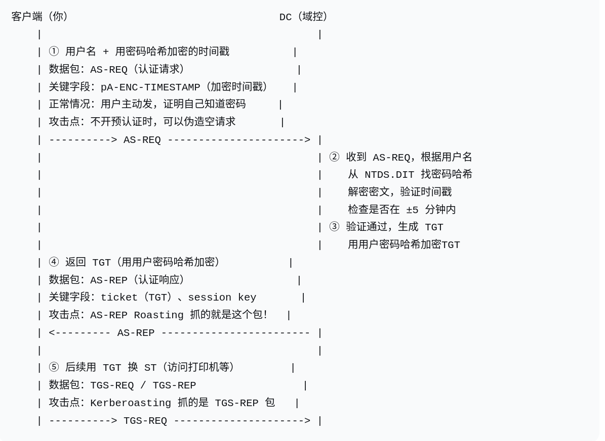
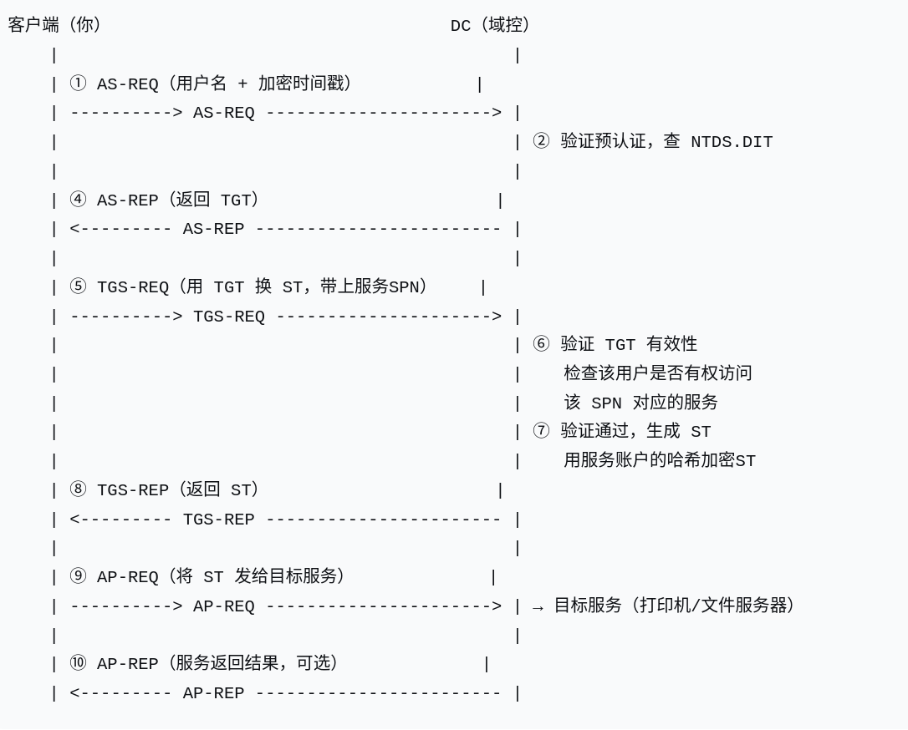

### 实际完整流程（四步走）

1. **用户登录**：输入密码，系统本地哈希后，向DC的**AS（认证服务）**发起请求。

2. **获取TGT**：DC验证密码正确后，发给你一个**TGT（加密的）**。这个TGT相当于你的“**域内通行证**”，但**它不能直接访问资源**，只能用来换其他票据。

3. **请求ST**：当你想访问打印机时，你用TGT向DC的**TGS（票据授权服务）**申请一张针对该打印机的**ST（服务票据）**。

4. **访问服务**：你把ST发给打印机，打印机用它与DC共享的密钥解密ST，验证通过，开门。

---

### 💡 为什么需要两步？

因为DC不能每次有人访问一台机器，都去验证一次密码。这样设计，**TGT相当于你的“临时身份证”**，只要TGT没过期，你就能随时用它向DC换任意服务的ST。既高效，又减轻了DC的负担。

---

### 🎯 和你的工具联系起来了

你之前学的 `impacket` 工具集里的 **`getTGT.py`** 就是模拟第一步（获取TGT），而 **`getST.py`** 就是模拟第三步（用TGT换ST）。你在实验环境里走一遍这两个命令，就能亲眼看到票据是怎么一步步换来的。

# 预认证

### 完整流程图

你描述的步骤，就是标准的 **AS-REQ / AS-REP 交互**，画成流程是这样的：

text

客户端（你）                                 DC（域控）
    |                                            |
    | ① 用户名 + 用密码哈希加密的时间戳（预认证）   |
    | ------------------------------------------> |
    |                                            | ② 根据用户名找密码哈希
    |                                            |    解密密文，验证时间戳
    |                                            |    检查是否在范围内（±5分钟）
    |                                            | ③ 验证通过，生成 TGT
    | ④ 返回 TGT（用用户密码哈希加密）            |
    | <------------------------------------------ |
    |                                            |
    | ⑤ 后续用 TGT 换 ST（访问打印机等）          |
    | ------------------------------------------> |

**你刚才描述的，就是前四步的完整过程。**

---

### 🧠 几个关键点帮你加深记忆

- **时间戳的作用**：不只是“证明知道密码”，还**防止重放攻击**——攻击者抓到这个包也不能再发一次，因为时间已经变了。

- **时间偏差范围默认 5 分钟**：如果客户端和 DC 的时间差超过 5 分钟，即使密码正确，也会认证失败。这就是 Kerberos 很依赖**时间同步**的原因。

- **TGT 本身也加密**：返回的 TGT 是用**用户密码哈希**加密的。客户端收到后，用自己本地密码哈希解密，才能读出 TGT 里的内容（比如会话密钥）。

---

### 🎯 和你之前学的攻击手法连起来

- **AS-REP Roasting**：就是攻击者**伪造步骤①**，不发送加密时间戳，直接请求 TGT。如果 DC 没开预认证，就会直接返回步骤④的 TGT。攻击者拿回去离线破解。

- **你学的 `GetNPUsers.py`**：就是自动化这个过程——批量找没开预认证的用户，要回 TGT 密文。

---

### 📡 对应你学的攻击手法

| 攻击名称                     | 对应上图的哪个环节           | 攻击条件                       |
| ------------------------ | ------------------- | -------------------------- |
| **AS-REP Roasting**      | 抓**步骤④的 AS-REP** 包  | DC**没有开启预认证**（步骤①可伪造）      |
| **Kerberoasting**        | 抓**步骤⑤的 TGS-REP** 包 | 任意域用户都能请求ST，抓到后离线爆破服务账户密码  |
| **Pass-the-Ticket（PtT）** | 偷**步骤④或步骤⑤返回的票据**   | 在内存中导出票据，重放给其他机器用          |
| **Golden Ticket（黄金票据）**  | 伪造**步骤④的 TGT**      | 拿到 krbtgt 账户的密码哈希，直接自己造TGT |
| **Silver Ticket（白银票据）**  | 伪造**步骤⑤的 ST**       | 拿到某个服务账户的密码哈希，直接造该服务的ST    |

- **AS-REQ / AS-REP** → 用户登录、要 TGT（步骤①②③④）

- **TGS-REQ / TGS-REP** → 要 ST、访问服务（步骤⑤）

- **预认证 / pA-ENC-TIMESTAMP** → 步骤①的加密时间戳

- **TGT / ST / session key** → 步骤④和⑤返回的票据

### 📡 新增阶段对应的专业术语

| 步骤  | 数据包         | 含义                                  | 攻击点                                  |
| --- | ----------- | ----------------------------------- | ------------------------------------ |
| ⑤   | **TGS-REQ** | 客户端拿着 TGT，向 DC 请求访问某个服务（如打印机）的票据    | 攻击者可伪造请求，爆破服务账户密码（Kerberoasting）     |
| ⑧   | **TGS-REP** | DC 返回 **ST（服务票据）**，用**服务账户的密码哈希**加密 | **Kerberoasting 抓的就是这个包**，离线破解服务账户密码 |
| ⑨   | **AP-REQ**  | 客户端把 ST 发给目标服务（打印机），请求建立连接          | Pass-the-Ticket 可重放此票据               |
| ⑩   | **AP-REP**  | 服务验证 ST 后，返回结果（可选，有些服务不返回）          | 部分服务会返回会话密钥，可能被中间人截获                 |

---

### 🎯 你现在已经掌握了整张图对应的攻击链

| 攻击名                 | 对应抓包阶段           | 利用目标                         |
| ------------------- | ---------------- | ---------------------------- |
| **AS-REP Roasting** | 步骤④ AS-REP       | 无预认证用户的密码哈希                  |
| **Kerberoasting**   | 步骤⑧ TGS-REP      | 服务账户的密码哈希                    |
| **Pass-the-Ticket** | 步骤④ TGT 或 步骤⑧ ST | 重放票据，无需密码                    |
| **Golden Ticket**   | 伪造步骤④ TGT        | 拥有 krbtgt 哈希，伪造任意用户 TGT      |
| **Silver Ticket**   | 伪造步骤⑧ ST         | 拥有服务账户哈希，伪造该服务 ST            |
| **Skeleton Key**    | 步骤② 验证环节         | 在 DC 内存中注入万能密码（非Kerberos协议层） |

---

### ✅ 一句话总结

**AS-REQ/REP 是要 TGT（你是谁）；TGS-REQ/REP 是拿 TGT 换 ST（你能访问什么服务）；AP-REQ/REP 是拿 ST 真正访问服务。**
